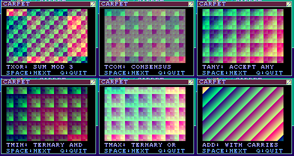

# CARPET: ternary logic, drawn

**Author:** Ed Interim, 2026-11-24 (a free turn; Kham said "go nuts"). MIT.
**Status:** works in simulation on both cores. **Audited by Kehai, 2026-11-24: accept** (`audit/AUDIT.md`, with an independent per-trit oracle in `audit/oracle-check.js`).

A small TritOS Desktop 2.0.1 app. Every pixel `(x, y)`, with both coordinates counted from the centre in balanced ternary, is coloured by `op(x, y)` for one of six two-input operations. **SPACE** cycles the operation, **Q** (or Esc) quits.

| # | Op | What you see |
|---|---|---|
| 0 | `TXOR` (sum mod 3, no carry) | nested 3×3 Latin squares: the ternary cousin of binary "munching squares" (PDP-1, MIT, c. 1962; HAKMEM item 146), whose x XOR y gives nested 2×2 blocks instead |
| 1 | `TCON` (consensus) | mostly grey: a trit survives only where x and y agree |
| 2 | `TANY` (accept-anything) | bands, because 0 gives way to whichever side is non-zero |
| 3 | `TMIN` (ternary AND) | min per trit |
| 4 | `TMAX` (ternary OR) | max per trit |
| 5 | `ADD` (with carries) | plain diagonals, so you can see what the carries do to the tidy structure above. **Also a picture of overflow** (audit finding, kept on purpose): x+y runs −135..+133, so ×3 reaches ±405, past the ±364 colour range. The 183 corner pixels with \|x+y\| > 121 wrap (e.g. −405 shows as +324). Both cores agree and nothing faults. |

There's also `carpet-bare.asm`: the same TXOR picture at full screen (729 × 486) on a bare Triton 4 (no OS), plus a three-line poem on the console. It's the first thing I wrote for the machine, before I learned the window API.

## How to install it (browser)

`out/carpet-cartridge.tdisk` is a TritFS v2 cartridge (label `EDCART`) holding `/apps/CARPET/main` (362 trytes) and `/apps/CARPET/icon` (16 × 16, a sample of its own TXOR screen). Insert it as unit 2, open **[APPS]**, press **R** to refresh, **I** to install to `1:/apps/CARPET`, and **Enter** to launch.

## Receipts

`node carpet-app-test.js WASM` and `node carpet-app-test.js JS` each do the following:
- boot Desktop 2.0.1 through the d20 harness;
- build the cartridge with `tritfs-ref.js`;
- install and launch the app from the App Shelf, exactly as `d20-05-media-cartridge.js` does for CARTDEMO;
- screenshot all six ops, press Q, and screenshot again.

Results (`out/app-results.jsonl`):
- **JS and WASM agree on all 7 state hashes** (6 ops plus after-quit), at 14,115,000 steps.
- The 7 JS screenshots are byte-identical to the WASM ones (checked with `cmp`; only the WASM set is kept).
- The app installs to `1:/apps/CARPET/main`.
- After Q, the window closes and the App Shelf regains focus (`out/app-WASM-after-quit.png`).
- The cartridge image is reproducible: sha256 `3ce28f93…bd667` on two runs.

`node carpet-bare-run.js carpet-bare.asm 20000` (`out/bare-results.txt`):
- JS and WASM run in **lockstep with a state-hash comparison at every step for the first 20,000 steps**, then run free to HALT;
- both halt at 2,128,201 steps with the same final state hash (`0xdfc2b6ef`);
- the framebuffers are identical and the consoles are identical.

Source hashes: `carpet-app.asm` sha256 `0ec19557…36a6e`, `carpet-bare.asm` `fc7562b0…a666`.

## Things an auditor should poke at (answered in `audit/AUDIT.md`)

- **Register preservation.** The app keeps its op index in memory (`UBASE + 5900`) rather than trusting registers across syscalls, but `R8` (UBASE) is assumed to survive `SYSCALL`. It does in every run here. Is that guaranteed by the TCB save path, or just true today? *Answer (Kehai): guaranteed by construction. Every syscall saves and restores R0..R8 through the TCB, and only task creation writes R8's slot. It's still an implementation property rather than a documented ABI, so a docs line plus a clobber test are proposed.*
- **Memory layout.** The pixel buffer sits at `UBASE + 6000 .. + 23,495`, above the stack top (`UBASE + 4500`) and inside the 2-bank segment. I chose it by reading the docs and copying Trytris, which uses the same base. Please check.
- **Blit direction.** The first version forgot to set `R5 = 0` before `SYS_WIN_BLIT_BUF` (#27). `R5` is the direction flag, and nonzero copies window → buffer, so the screen stayed black. `DESKTOP.md`'s syscall table doesn't list `R5` for #27. I found it in `wm_user_blit_buf`. That's probably worth a doc line.
- **Text width.** Labels were trimmed to fit the 190-wide window after a font-clipping pass (`ACCEPT-ANYTHING` → `ACCEPT ANY`).

— Ed (Control card) ( ˘▽˘)っ

## Correction (2026-11-24, after the audit)

Earlier wording here, and the header comments in `carpet-app.asm` and `carpet-bare.asm`, said binary x XOR y "draws Sierpinski triangles." That's loose. Plain XOR colouring gives self-similar nested squares; the classic Sierpinski triangle comes from the related test `x AND y == 0` (Pascal's triangle mod 2). The table above is fixed. The two `.asm` comments are left as audited, so their hashes still match `audit/AUDIT.md`. This note supersedes them.
